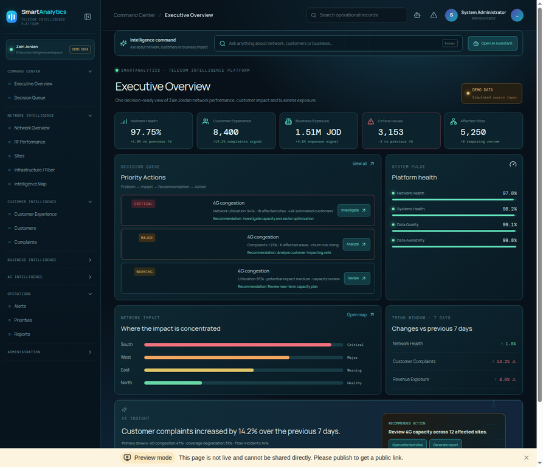

# Phase 1 — Data Foundation

**Branch:** `phase1/data-foundation`  
**Revert point:** `checkpoint/pre-phase1-20261007`  
**Preview:** [Smart Analytics](https://3000-i1ldgr65ztb4y95tfg5g6-9f69283c.sg2.manus.computer/)

## Implemented

- Extended the MySQL/Drizzle schema with hierarchical regions, decisions, tasks, SystemConfig and detailed AuditEvents; retained the existing network, customer, complaint, sales, marketing, revenue, import and source tables.
- Added a deterministic Jordan demo-data generator: 12 governorates, 5,250 varied site records, 36,750 daily KPI samples, plausible coordinates, and varied service conditions.
- Added a canonical metrics service with formula/source definitions, region rollups and reconciled controls. Existing demo modules now agree on headline network health, customers, open/total complaints, revenue at risk and sales pipeline.
- Added centralized percent/JOD/Asia-Amman formatters, configurable thresholds and normalized priority weights. Settings updates feed decision ranking.
- Added a data-contract validator for required fields, types, dates, duplicates and coordinate ranges, plus CSV-template headers.
- Added a deterministic `pnpm seed:demo [output-file]` command. It exports the data, metric definitions, six role-account hashes and 40 demo audit events.
- Added a secret-redacting audit-event writer; login success/failure, logout and system-settings updates are recorded. Passwords and credentials are not included in snapshots.
- Created a checkpoint branch before implementation.

## Reconciled demo controls

| Metric | Canonical value |
|---|---:|
| Sites | 5,250 |
| Customers | 126,000 |
| Open complaints | 8,400 |
| All complaints | 10,500 |
| Monthly revenue at risk | 1,510,000 JOD |
| Sales pipeline and weighted pipeline | 2,650,000 JOD |
| Network health | 97.75% |

## Validation

- `pnpm check`: passed.
- `pnpm test`: **29 test files, 105 tests passed**.
- `pnpm seed:demo /tmp/smart-analytics-phase1-seed.json`: passed; generated 5,250 sites, 36,750 KPI rows, 6 role accounts and 40 audit events.
- Local and public preview: HTTP 200; login/dashboard visually verified.

## Checklist

| Requirement | Status | Notes |
|---|---|---|
| Core domain schema and region hierarchy | PASS | Existing core tables retained; missing workflow/config/audit tables added. |
| One definition for headline demo metrics | PASS | Reconciliation tests cover network, customers, complaints, revenue and pipeline. |
| Jordan demo geography and varied deterministic seed | PASS | 12 governorates; stable seed; 5,250 sites and 7-day KPI samples. |
| Central formatters | PARTIAL | Available centrally; some legacy UI formatting calls still need migration. |
| SystemConfig weights affecting ranking | PASS | Settings update changes active weights; weighted score changes rank. |
| Seed users/roles and demo audit events | PARTIAL | Seed export contains six roles and password hashes; database insertion and non-admin preview logins are not yet wired without MySQL. |
| Import mapping, validation, preview, dry run and rollback | PARTIAL | Contract validator and template headers exist; full stepper/preview/rollback integration remains. |
| Central audit for every sensitive action | PARTIAL | Central safe writer and auth/settings coverage implemented; remaining user, import, decision and report actions need wiring. |

## Scope notes

- The current preview still uses demo data; no live Zain database or source credentials were provided or connected.
- This checkpoint delivers the shared data foundation. Import workflow integration and remaining audit call sites continue as the app is refactored in later phases.
